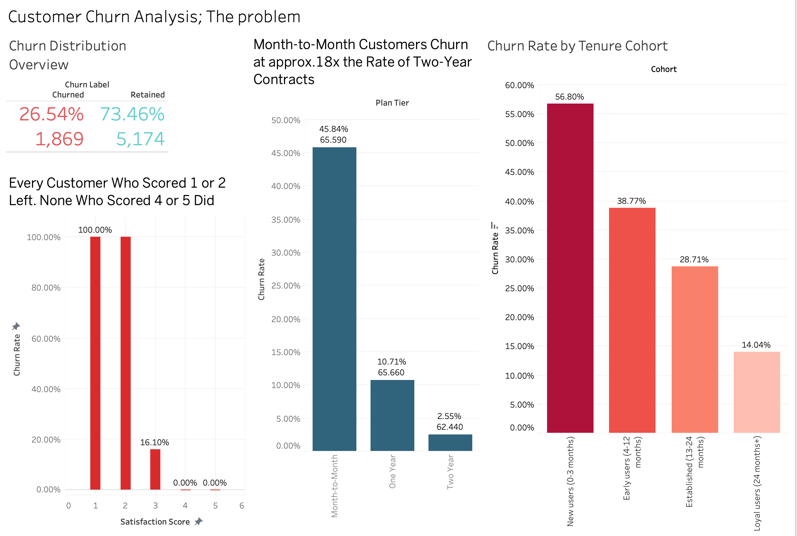
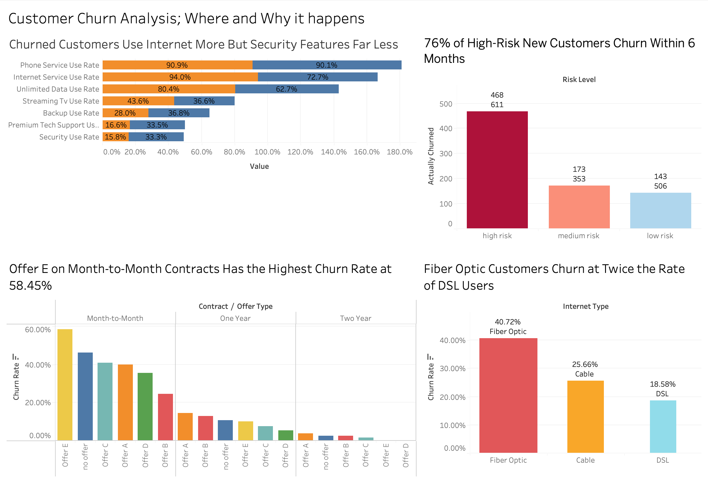
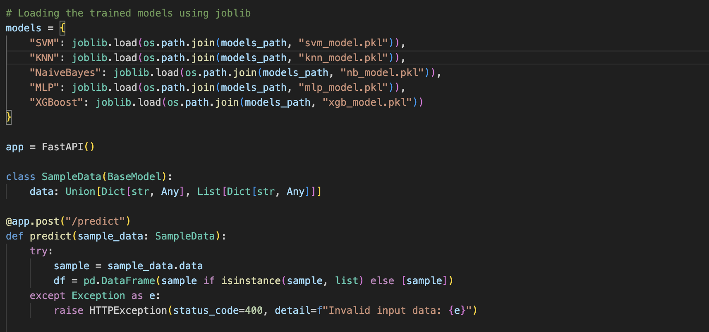
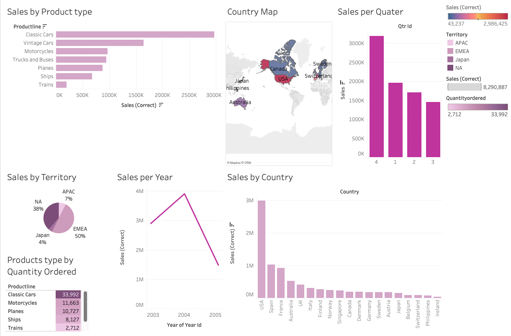
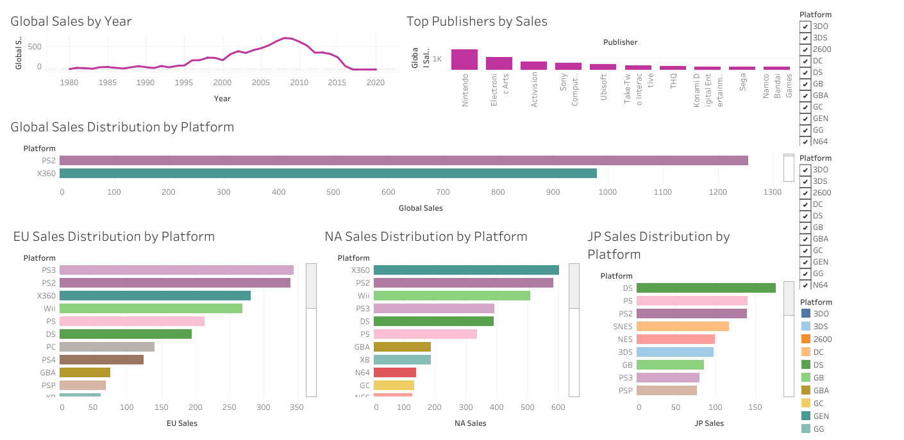
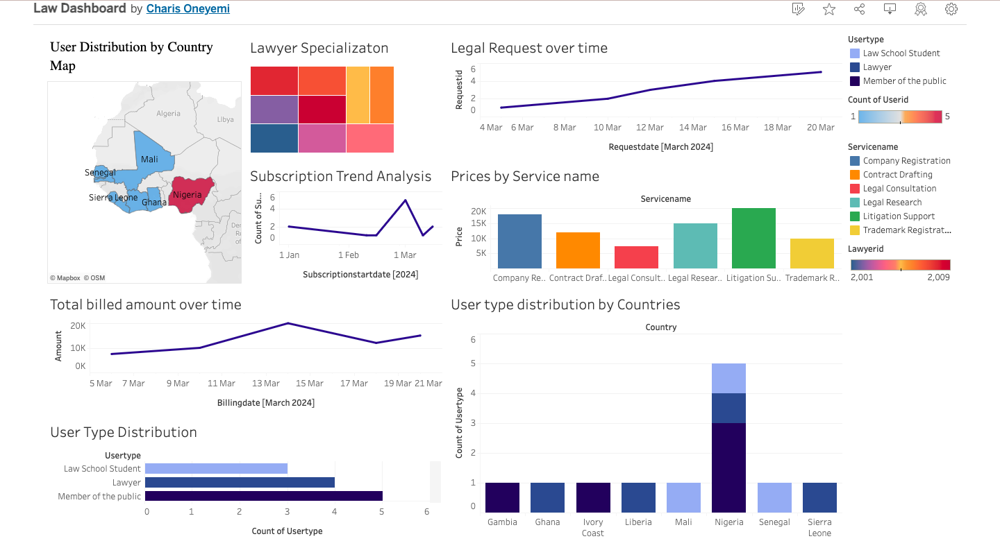
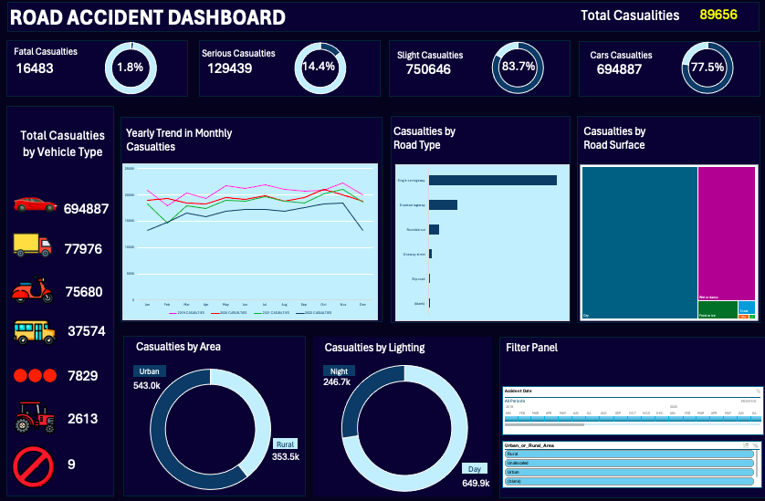
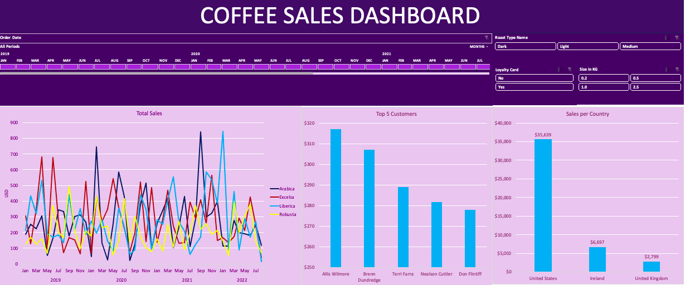

# Turning User Data Into Product Decisions

### Product Operations Manager | MSc Data Science

With a background spanning **telecom analytics**, **early-stage startup execution**, and an **MSc in Data Science**, I turn messy user behavior data into onboarding fixes, retention strategies, and product roadmaps that align user needs with business outcomes. I work across the full loop — from SQL and Python analysis to stakeholder-facing dashboards to the product decisions that follow.

#### Core skills: Product Operations, Growth Analytics, Cross-Functional Execution, Stakeholder Communication, SQL, Python (Pandas, Scikit-Learn), Tableau, Cohort & Retention Analysis, Customer Segmentation, Dashboard Development, KPI Tracking, Experimentation Thinking

#### LinkedIn: linkedin.com/in/charisoneyemi
#### Gmail: charisoneyemi@gmail.com
#### GitHub: https://github.com/Tsemaye

---

## Education
- MSc Data Science | Pan Atlantic University (2024-2025)
- BSc Management Information System | Covenant University (2017-2022)

## Product & Analytics Projects
### Customer Churn & Retention Analysis
#### PostgreSQL • Tableau 
I used a public telecom dataset (7,000+ customer records) to practice a real product-analytics workflow: finding why customers churn, not just that they churn. The analysis traced the biggest losses back to weak onboarding and short-term contract structures.

#### Key Insights
• New customers churned at 56.8%

• Month-to-month users churned 18x more than long-term contract users

• Customers with low satisfaction scores consistently churned

• Retention improved significantly after long-term commitment

#### What I Explored
• Cohort retention analysis

• Feature adoption patterns

• Customer risk segmentation

• Offer effectiveness

• Contract behavior analysis

#### Full Case Study
* [Detailed Project Breakdown & Recommendations](https://drive.google.com/file/d/1YFGWGgIegadBB__hNtyPq89vyoz40_ar/view?usp=sharing)
* [Interactive Dashboard: The Churn Problem](https://public.tableau.com/views/TheChurnProblem/TheChurnProblem?:language=en-GB&publish=yes&:sid=&:redirect=auth&:display_count=n&:origin=viz_share_link)
* [Interactive Dashboard: Where & Why It Happens](https://public.tableau.com/views/CustomerChurnAnalysisWhereandWhyithappens/WhereWhyItHappens?:language=en-GB&publish=yes&:sid=&:redirect=auth&:display_count=n&:origin=viz_share_link)

---

### Fraud Classification Model and Deployment

Fraud detection is fundamentally a trade-off problem between false positives and missed fraud. Using a public financial transactions dataset, I built and stress-tested five classification approaches (XGBoost, SVM, KNN, MLP) to compare their trade-offs, then deployed the strongest one as a working API.
[Python Machine Learning Model](https://github.com/Tsemaye/Python-Machine-Learning)

## Additional Projects

### Retail Sales Trends by Region & Product Line

Practiced building an exploratory Tableau dashboard on public retail sales data — surfacing revenue patterns by product line, region, and season the way I would for a real stakeholder-facing report.
[Retail Sales Data Analysis](https://charisoneyemi.wordpress.com/2024/06/28/retail-sales-data-analysis-a-first-glance-2/)

### Video Game Market Analysis by Platform & Region

[Video Games Sales Analysis Dashboard.png
](https://github.com/Tsemaye/portfolio/blob/main/Video%20Games%20Sales%20Analysis%20Dashboard.png)

Used a public global video game sales dataset to explore how regional markets differ — a title that dominates in Japan can flop in North America — and broke down sales by publisher, platform, and genre to map where those gaps show up.
[[Publication](https://www.mdpi.com/1424-8220/22/8/3048)
](https://public.tableau.com/app/profile/charis.oneyemi7497/viz/VideoGameAnalysis_17101490196120/VideoGamesSalesAnalysisDashboard)

### Legal Services Operations Dashboard

Built a mock operational dashboard for a legal services use case, tracking performance metrics, workflow activity, and billing — practicing the kind of reporting that helps leadership spot bottlenecks and make staffing decisions.
[Legal Services Analysis](https://public.tableau.com/views/LawDashboard_17108603340770/Dashboard1)

### Road Accident Trends by Region & Condition

Used a public road accident dataset to practice identifying which conditions — geography, weather, vehicle type — most reliably predicted accident severity, the kind of analysis that informs real safety prioritization.
https://bit.ly/3uZrrTk

### Coffee Sales Trends by Product & Segment

Analyzed a public coffee sales dataset across product categories, roast types, and customer segments to practice surfacing which combinations actually drive revenue versus which just look busy.
https://bit.ly/3IyZ0Pe

### Employee Data Analysis (SQL)

https://github.com/Tsemaye/SQL

Practiced SQL (JOINs, CASE statements, GROUP BY, aggregations, filtering) on a public employee dataset to explore demographics, salary bands, and tenure trends.

## Work Experience

**Product Operations Manager  @ Maestroverse (_October 2025 - Present_)**
Coordinated cross-functional execution across engineering, design, and social media teams in a pre-launch startup environment. Built and maintained internal documentation, workflows, and knowledge systems in Notion to support structured decision-making. Defined success criteria and tracked execution against milestones, flagging risks and driving resolution across teams. Served as the primary communication bridge between the founder and all functional teams, ensuring clarity and accountability on priorities.

  
**Partner Support Volunteer  @ YouVersion (_June 2024 - February 2026_)**
Analyzed 250+ recurring user inquiries to identify patterns and surface insights that improved internal support workflows. Synthesized user feedback into structured reports communicated to internal teams for process improvement. Maintained documentation and knowledge systems to improve response quality and operational efficiency.

 
**Basic Technology Instructor/Teacher  @ National Youth Service Corps (_June 2022 - May 2023_)**
Communicated technical concepts clearly to non-technical audiences and iterated on delivery based on feedback. Managed scheduling, resources, and operations for a structured learning environment of 200+ students.

**Operations Administrative Assistant @ Quantum Business School (_June 2020 - Nov 2020_)**
Coordinated daily administrative operations, including appointment scheduling, document management, and workflow coordination. Streamlined scheduling processes to improve operational efficiency, optimize time management, and support smooth day-to-day operations.

Isaiah 60
